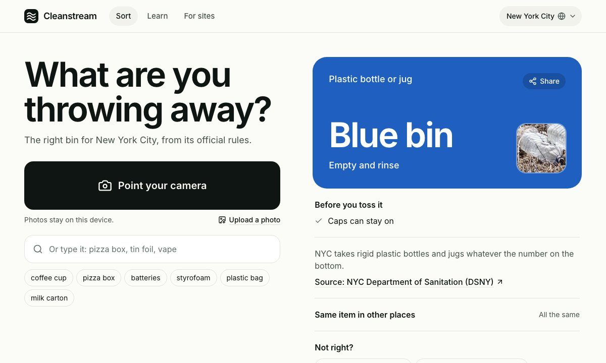
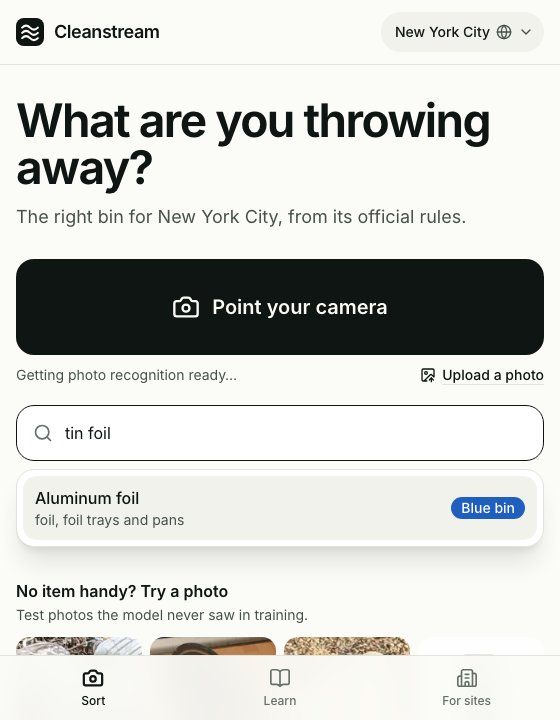
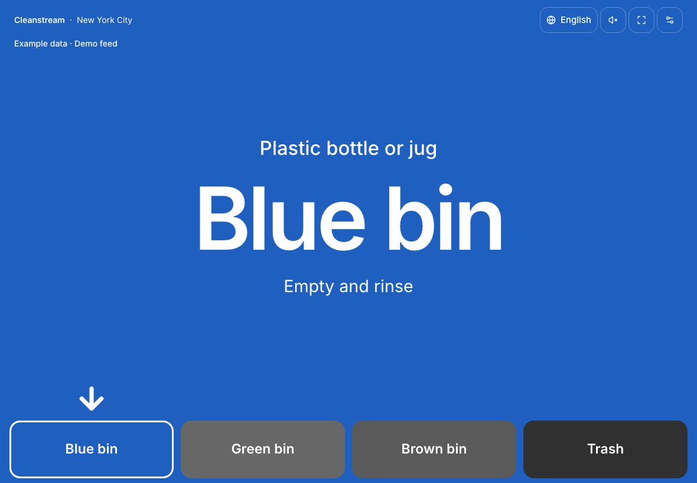
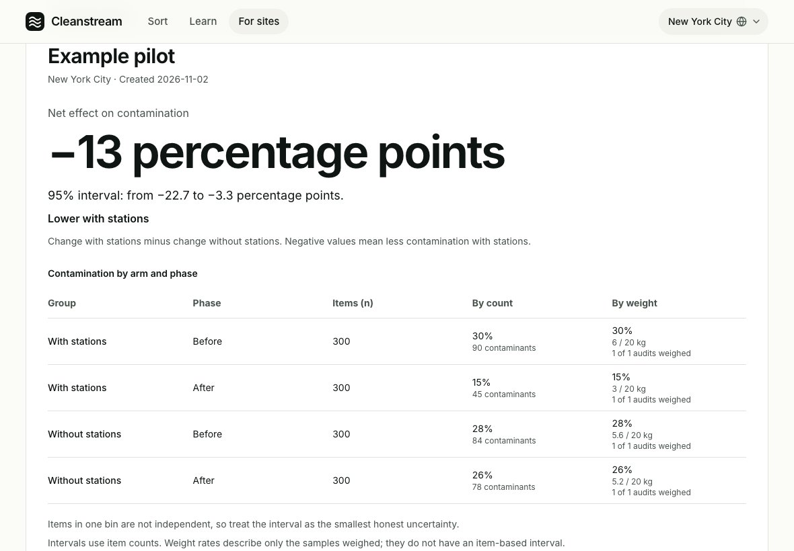

# Cleanstream

**Which bin? Cleanstream answers with your city's rules, and helps you prove your bins got cleaner.**

Live app: https://yy5652-hash.github.io/cleanstream/ (runs in your browser; photos never leave your device)

<p> </p>

Cleanstream is a web app for the moment someone stands in front of three bins holding a coffee cup. Show it the item and a
model running in the browser recognises it, then answers with the local rules: which bin, how to prep it, why, and a
link to the official source. The same model powers a bin-station mode for an old tablet mounted above shared bins, and
an audit mode that turns a standard bin audit into a few minutes of photos, so a site can measure contamination before
and after a change.

Built for ArbiterHacks V1, Theme Track: Rethinking Waste.

## The waste problem it targets

Contamination: things in recycling and compost bins that don't belong there. In New York City, contamination in the
metal, glass and plastic recycling stream was 27.5% in 2023, up from 18.7% in 2017 (DSNY 2023 Waste Characterization
Study). The Recycling Partnership estimates contamination costs the US recycling system more than $300 million a year.
Some contaminants are dangerous: an EPA report counted 245 lithium-ion battery fires at 64 waste facilities from 2013
to 2020 and calls that count severely underreported.

The right answer depends on the item and on the city. A paper coffee cup goes in the green paper bin in New York and
the blue bin in San Francisco, and in the trash in Los Angeles. Cleanstream answers that question at the bin, and gives sites a cheap way to measure
whether answering it changed anything.

**How we would measure it.** Pick six shared bin stations (for example, campus building lobbies). Audit each station's
recycling bin weekly for two weeks with Cleanstream's audit mode, alongside a standard weight-based audit of the same
bags. Then mount a bin-station tablet at three of the stations for four weeks and keep three as controls. The outcome
is the change in contamination rate at tablet stations minus the change at control stations (by weight, with item
counts from the audit mode as a second view), plus which contaminants dropped. Feedback programs have moved this number
before: The Recycling Partnership's cart-tagging work cut contamination 31% in Atlanta and 37% in Grand Rapids.

## What it does

| Tab | What you get |
| --- | --- |
| **Scan** | Camera, upload or a held-out test photo. The bin for your city, how sure the model is, prep steps, the reason, the official source, and what the same item gets in other cities. One tap corrects it. Or type the item: search knows everyday names (tin foil, Amazon box, styrofoam). Every answer has a share link (`#scan?item=pizza_box&city=sf`), and the app installs to a home screen and works offline. |
| **Bin station** | Kiosk for a tablet above a set of bins, modelled on commercial sorting stations. While idle it greets people in several languages and shows the items most often binned wrong; when an item is held still it fills the screen with that bin's colour and points at the right lid. It notices an item by the share of the view that changed (changes in light are ignored) and classifies a crop around it, so small items count. Set which bins stand there and in what order; open `?kiosk` on the tablet for a full-screen station. When it is not sure it offers the two likeliest items as big buttons to tap. It can say the answer out loud. It keeps counts, never pictures, and a station report shows items per day and bin, the items people ask about most and how often it was unsure, with CSV export. |
| **Audit** | Photograph each item pulled from a bin (drop a whole batch). It sorts them, flags what doesn't belong, gives the contamination rate and top contaminants, compares baseline and after audits, and exports CSV. |
| **Rules** | The full rule table for New York, San Francisco, Los Angeles, Chicago, Seattle and US general guidance (EPA and The Recycling Partnership), with a source link on every row and a filter for items where places disagree. |
| **Quiz** | Ten everyday items, pick the bin under your city's rules; half are items places disagree on. Ends with what to remember and a score to share. Built for campus orientation and classrooms. |
| **How it works** | The model, the evaluation numbers below, data sources and licences. |

<p> </p>

Every resident-facing screen, rule and search also works in Spanish, Simplified Chinese and Traditional Chinese. The
language follows the browser, and `?kiosk&lang=es` sets a station's own language. Search understands everyday words in
the chosen language and in English ("unicel", "pilas", "保麗龍"), and the station speaks in that language. A kiosk returns
to its own language after 45 idle seconds. The translations are machine-made and say so, with the official source a tap
away; `web/src/i18n.test.ts` checks that every string, rule and prep step is present.

## How it works

1. **Photo.** Never uploaded. Everything below runs in a Web Worker with ONNX Runtime Web (WebAssembly), on several threads
   where the browser allows it: the service worker adds the isolation headers that needs, so a first visit reloads once.
2. **Image encoder.** SigLIP 2 ViT-B/16 (256 px, open weights, Apache 2.0). We store its weights in 8 bits with one scale
   per output channel and dequantize at load, so the file is 95 MB and the arithmetic stays 32-bit. `ml/export_onnx.py`
   compares the file with the original model; with the earlier ViT-B/32 file the mean embedding cosine to the original
   was 0.998 over 300 test photos (`ml/parity.py`).
3. **Item head.** A linear classifier over 32 item types. The types follow the rules, not the material: a plastic bottle
   and a plastic bag are both plastic, but most cities want them in different places.
4. **Rule pack.** JSON per city: bins, and for each item type the main bin, any other accepted bin, prep steps, the
   reason and the source URL.
5. **Answer or ask.** Item probabilities are summed per bin. The app can be sure of the bin even when two look-alike
   items split the vote, and below 60% for the top bin it says it is not sure.

### Training the item head

- **Data.** Seven open sources, 29,095 training photos in all: TrashNet (MIT), the Garbage Dataset v2 (MIT), object crops
  from TACO, real litter photos (CC BY 4.0), Recyclable and Household Waste Classification (MIT, 15,000 photos, studio and
  real-world), WaRP recycling-plant crops (CC0), the E-Waste Image Dataset (Apache 2.0, with microwaves and washing
  machines left out) and 390 Wikimedia Commons photos (CC0, public domain or CC BY) for the rarest item types, each checked
  by eye; credits are in [`ml/commons_credits.csv`](ml/commons_credits.csv). Splits are fixed by a hash of the source
  photo, so crops of one TACO photo never land in two splits. Training photos that are near-copies of any test photo
  (embedding cosine above 0.97) are removed first.
- **Equal say for each source.** Each source gets the same total weight in the loss (`ml/train.py --balance 1`), so the
  largest source does not decide where the boundaries fall.
- **Cleaner labels.** The Garbage Dataset and RealWaste file milk, juice and soup cartons under "cardboard", but New
  York wants cartons in the blue bin and cardboard in the green one. `ml/fix_labels.py` relabels a cardboard photo as a
  carton when the encoder's text score favours "carton" over "cardboard" by at least 0.03 (a threshold set by looking
  at photos on both sides of it), in every split, before training: 694 photos. Measured on the corrected labels, this
  lifted NYC bin accuracy on held-out photos from 91.2% to 95.2% (at that time, with the first model and the first three
  sources).
- **Text-anchored head.** The classifier starts from the encoder's own text embeddings of each item ("a crumpled chip
  bag", "a greasy pizza box") and an L2 penalty (strength 0.001) pulls it back toward them while it trains.
- **Partial labels.** Thousands of photos are labelled only "plastic" or "metal". They train the head with a
  partial-label loss: the probability summed over that material's item types.
- **No photos, no drift.** An item type with no training photo only ever sees negatives and learns to reject whatever
  background the other datasets have, so `ml/train.py` keeps such a type at its text-only weights. Early on this applied to
  yard waste and electronics: freezing them and dropping class-balanced loss weights lifted NYC bin accuracy on RealWaste
  from 63% to 70% with the earlier encoder. That is history: with the sources above, all 32 item types now have training
  photos (counted from `data/manifest.csv`, train rows of the seven sources, before near-duplicates are removed). Some
  are thin: yard waste has 6, pizza box 9 and squeezable tube 10. They learn from few examples and stay close to their text
  weights, and the held-out test split has too few photos of them to measure each one on its own.
- **Choices made on validation photos.** The anchor strength is picked on the validation split plus leave-one-dataset-out
  validation, which rewards generalising to a new photo source. The encoder and head settings were compared on validation
  photos only, photo by photo (`ml/compare.py`, a paired test): ViT-B/16 beat ViT-B/32 on item type and bin. The first
  encoder had been picked from four open models (OpenAI CLIP, LAION-2B CLIP, DataComp CLIP, SigLIP 2) with the same pipeline.
- **What we looked at.** RealWaste is never trained on, but we looked at it twice during development. At the first look an
  earlier candidate had lifted everyday photos and lost 6 points on RealWaste, so we went back to the validation photos and
  added recycling-plant photos, then looked once more and stopped tuning. The shipped model is stronger on everyday items and
  weaker on landfill photos than the first model: 79.3% to 71.0% for New York's bins on RealWaste. That first look also
  covered the held-out test photos and the web field test, and the field test's errors on mugs and pizza boxes are why we
  added photos of those types. Treat all three as slightly optimistic.
- **Tried and not shipped.** Averaging each photo's answer with its mirror image's (`ml/tta_eval.py`, a paired test
  photo by photo, measured with the first model): NYC right-bin accuracy 95.2% to 95.1% on held-out photos and 79.3% to
  79.0% on RealWaste, no significant change for any city (McNemar p > 0.35) at twice the compute, so the app runs one pass
  per photo. And 21 further Wikimedia Commons photos: a paired comparison showed no gain, so they were not adopted.

## Results

The head is trained by `ml/train.py` on embeddings from the shipped 8-bit weights (`ml/embed_int8.py`, which runs on a GPU
because `encoder.onnx` itself is slow on a CPU). The numbers below are then computed by `ml/final_eval.py` from the
`encoder.onnx` file the page downloads. "Bin" counts the bin the app would show as correct when the city accepts that item
there. Four test sets:

- **All held-out test photos** from the seven training sources.
- **Original three sources**: the held-out test photos from TrashNet, the Garbage Dataset and TACO only. Their photos and
  splits have not changed, so this row is comparable with earlier versions of this model.
- **RealWaste**: photos of real waste on a landfill sorting line, never trained on. It shows how the model holds up on
  photos unlike its training data, but see "What we looked at" above.
- **Web field test**: 88 stock photos and video frames of everyday items from Pexels, labelled by looking at each one
  (listed in [`ml/field.csv`](ml/field.csv)), never trained on, but see "What we looked at" above.

<!-- results:start -->
| Test set | Model | Item type | Material |
| --- | --- | --- | --- |
| All held-out test photos (6,490 photos) | Text prompts only (zero-shot) | 69.9% | 83.7% |
|  | **Cleanstream** | 92.7% | 95.0% |
| Held-out test photos from TrashNet, Garbage Dataset and TACO only (2,079 photos) | **Cleanstream** | 90.7% | 95.4% |
| RealWaste, never seen (2,546 photos) | Text prompts only (zero-shot) | 45.8% | 76.4% |
|  | **Cleanstream** | 55.9% | 81.9% |
| Web field test: stock photos and video frames of everyday items (88 photos) | **Cleanstream** | 89.8% | — |

Right bin under each city's rules (the same model and photos; only the rule pack changes):

| Rules | Held-out test: zero-shot | Held-out test: **Cleanstream** | Original three sources: **Cleanstream** | RealWaste: zero-shot | RealWaste: **Cleanstream** | Field test: **Cleanstream** |
| --- | --- | --- | --- | --- | --- | --- |
| New York City | 80.0% | 97.1% | 94.8% | 61.5% | 71.0% | 95.5% |
| San Francisco | 80.4% | 97.5% | 95.2% | 64.4% | 72.2% | 93.2% |
| Los Angeles | 78.3% | 97.4% | 95.0% | 62.4% | 71.8% | 92.0% |
| Chicago | 82.2% | 97.7% | 95.6% | 68.1% | 73.3% | 90.9% |
| Seattle | 79.6% | 97.9% | 96.1% | 64.4% | 72.3% | 93.2% |
| US (general) | 84.4% | 97.8% | 95.7% | 67.0% | 74.8% | 95.5% |

Item type and bin columns use photos with an item label. The material column also counts photos labelled only by material (6,992 for the held-out test and 4,257 for RealWaste). A dash means the set has no labels of that kind.

The app says it is not sure when the top bin gets less than 60% of the probability, and answers otherwise. With NYC rules, on held-out test photos it answers 98.0% of the photos and is right on 98.1% of those; on RealWaste it answers 85.7% of the photos and is right on 75.2% of those.
<!-- results:end -->

## Run it

```bash
cd web
npm install
npm run dev        # http://localhost:5173/cleanstream/
npm test           # rule-pack coverage, bin logic, contamination maths
npm run build
```

Retrain from scratch (Python 3.12):

```bash
uv venv --python 3.12 .venv && uv pip install --python .venv/bin/python torch torchvision open_clip_torch scikit-learn onnx onnxruntime onnxscript pillow numpy tqdm
# put the datasets under data/ (see ml/prepare.py): the seven training sources and RealWaste; ml/fetch_commons.py fills
# data/commons; the web field test photos are the Pexels files named in ml/field.csv (data/field). Then:
.venv/bin/python ml/prepare.py
.venv/bin/python ml/export_onnx.py ViT-B-16-SigLIP2-256:webli web/public/model
.venv/bin/python ml/embed_int8.py ViT-B-16-SigLIP2-256:webli web/public/model
.venv/bin/python ml/train.py ViT-B-16-SigLIP2-256__int8__onnx --lam 0.001 --balance 1 --export web/public/model
.venv/bin/python ml/final_eval.py ViT-B-16-SigLIP2-256:webli web/public/model ViT-B-16-SigLIP2-256__int8__onnx
.venv/bin/python ml/samples.py && .venv/bin/python ml/readme_results.py
```

`ml/relabel.csv`, `ml/commons_keep.txt` and `ml/commons_drop.txt` are in the repository; `ml/fix_labels.py`,
`ml/fetch_commons.py` and `ml/filter_commons.py` regenerate them. `ml/compare.py` compares two trained heads photo by photo.

## Repository

| Path | What |
| --- | --- |
| `web/` | The app: React + TypeScript + Vite, ONNX Runtime Web in a worker, no backend |
| `web/public/rules/` | Rule packs (New York, San Francisco, Los Angeles, Chicago, Seattle, US general) with sources |
| `web/public/model/` | `encoder.onnx`, the trained head, preprocessing and evaluation metrics |
| `ml/` | Dataset preparation, Commons photo fetching, embedding (`embed_int8.py` for the shipped 8-bit weights), training, paired comparison (`compare.py`), final evaluation (`final_eval.py`), export and parity checks |
| `ml/commons_credits.csv` | Title, author, licence and page of every Wikimedia Commons photo fetched for training |
| `ml/field.csv` | The web field test: file and label of each of the 88 everyday photos |

## What's next

- A pilot at campus bin stations with the measurement plan above.
- More rule packs. A pack is one JSON file, and the Rules tab shows what a city would need to fill in. Adding a city
  needs no retraining: `ml/eval_packs.py` scores the shipped model under the new rules on the same held-out photos.
- More training photos for the item types that have the fewest today (yard waste, pizza box, squeezable tube), and photos
  taken at bin stations, which are the closest match to real use.
- Optional sharing of station counts and audits across a campus, keeping images on the device.

## Credits

Code: MIT licence (see `LICENSE`).

Datasets: [TrashNet](https://github.com/garythung/trashnet) (MIT),
[Garbage Dataset v2](https://www.kaggle.com/datasets/sumn2u/garbage-classification-v2) (MIT),
[TACO](http://tacodataset.org) (CC BY 4.0),
[Recyclable and Household Waste Classification](https://www.kaggle.com/datasets/alistairking/recyclable-and-household-waste-classification) (MIT),
[WaRP](https://www.kaggle.com/datasets/parohod/warp-waste-recycling-plant-dataset) (CC0),
[E-Waste Image Dataset](https://www.kaggle.com/datasets/akshat103/e-waste-image-dataset) (Apache 2.0),
390 photos from [Wikimedia Commons](https://commons.wikimedia.org) (CC0, public domain or CC BY; photographer, licence and
page of each in [`ml/commons_credits.csv`](ml/commons_credits.csv)), and for evaluation only:
[RealWaste](https://archive.ics.uci.edu/dataset/908/realwaste) (CC BY-NC-SA 4.0, not redistributed) and the web field test
photos from [Pexels](https://www.pexels.com) (listed in `ml/field.csv`, not redistributed). Encoder: SigLIP 2 (Google, Apache 2.0) via
[open_clip](https://github.com/mlfoundations/open_clip). Rules: DSNY and NYC311; Recology and SF Environment; LA Sanitation; Chicago Streets and Sanitation; Seattle Public
Utilities; US EPA and
The Recycling Partnership (links on every row of the Rules tab). Sample photos in the app are held-out test photos from
TrashNet, the Garbage Dataset and TACO.
