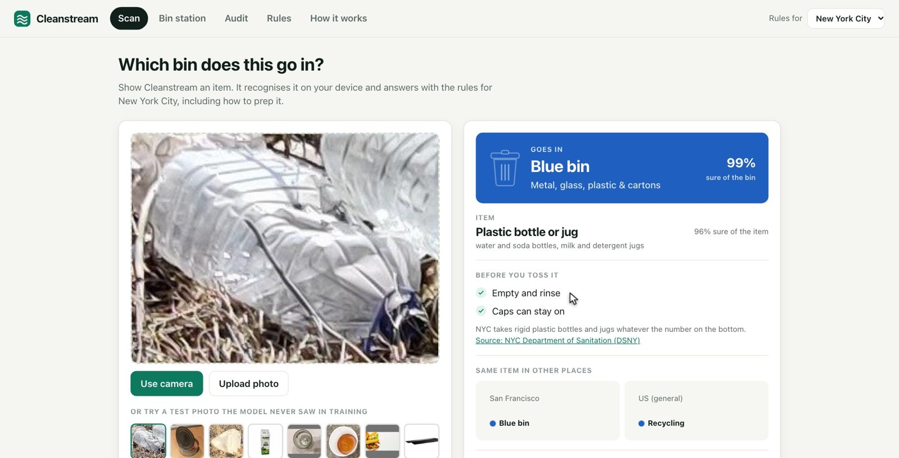
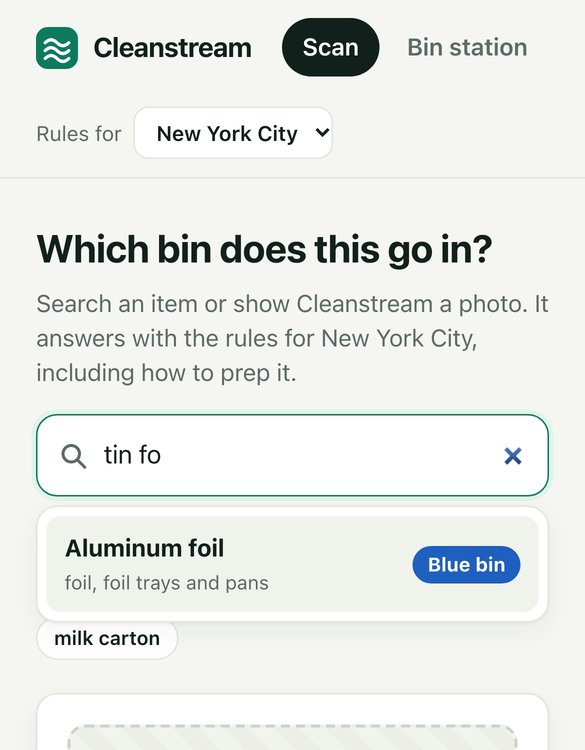
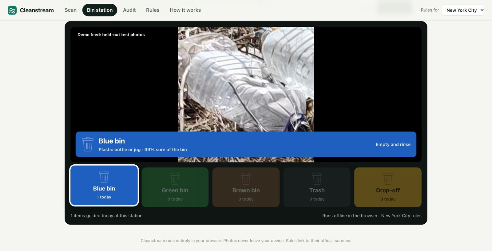
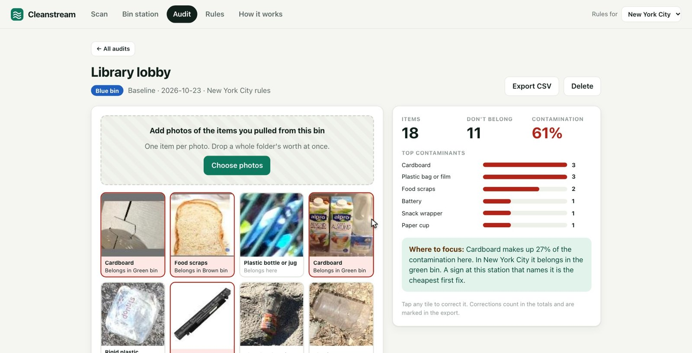

# Cleanstream

**Which bin? Cleanstream answers with your city's rules, and helps you prove your bins got cleaner.**

Live app: https://yy5652-hash.github.io/cleanstream/ (runs in your browser; photos never leave your device)

<p> </p>

Cleanstream is a web app for the moment someone stands in front of three bins holding a coffee cup. Show it the item and a
model running in the browser recognises it, then answers with the local rules: which bin, how to prep it, why, and a
link to the official source. The same model powers a bin-station mode for an old tablet mounted above shared bins, and
an audit mode that turns a standard bin audit into a few minutes of photos, so a site can measure contamination before
and after a change.

Built for ArbiterHacks V1, Theme Track: Rethinking Waste.

## The waste problem it targets

Contamination: things in recycling and compost bins that don't belong there. In New York City, contamination in the
metal, glass and plastic recycling stream was 27.5% in 2023, up from 18.7% in 2017 (DSNY 2023 Waste Characterization
Study). The Recycling Partnership estimates contamination costs the US recycling system more than $300 million a year.
Some contaminants are dangerous: an EPA report counted 245 lithium-ion battery fires at 64 waste facilities from 2013
to 2020 and calls that count severely underreported.

The right answer depends on the item and on the city. A paper coffee cup goes in the green paper bin in New York and
the blue bin in San Francisco, and in the trash in Los Angeles. Cleanstream answers that question at the bin, and gives sites a cheap way to measure
whether answering it changed anything.

**How we would measure it.** Pick six shared bin stations (for example, campus building lobbies). Audit each station's
recycling bin weekly for two weeks with Cleanstream's audit mode, alongside a standard weight-based audit of the same
bags. Then mount a bin-station tablet at three of the stations for four weeks and keep three as controls. The outcome
is the change in contamination rate at tablet stations minus the change at control stations (by weight, with item
counts from the audit mode as a second view), plus which contaminants dropped. Feedback programs have moved this number
before: The Recycling Partnership's cart-tagging work cut contamination 31% in Atlanta and 37% in Grand Rapids.

## What it does

| Tab | What you get |
| --- | --- |
| **Scan** | Camera, upload or a held-out test photo. The bin for your city, how sure the model is, prep steps, the reason, the official source, and what the same item gets in other cities. One tap corrects it. Or type the item: search knows everyday names (tin foil, Amazon box, styrofoam). Every answer has a share link (`#scan?item=pizza_box&city=sf`), and the app installs to a home screen and works offline. |
| **Bin station** | Kiosk for a tablet above a set of bins, modelled on commercial sorting stations. While idle it greets people in several languages and shows the items most often binned wrong; when an item is held still it fills the screen with that bin's colour and points at the right lid. Set which bins stand there and in what order; open `?kiosk` on the tablet for a full-screen station. When it is not sure it offers the two likeliest items as big buttons to tap. It can say the answer out loud. It keeps counts, never pictures, and a station report shows items per day and bin, the items people ask about most and how often it was unsure, with CSV export. |
| **Audit** | Photograph each item pulled from a bin (drop a whole batch). It sorts them, flags what doesn't belong, gives the contamination rate and top contaminants, compares baseline and after audits, and exports CSV. |
| **Rules** | The full rule table for New York, San Francisco, Los Angeles, Chicago, Seattle and US general guidance (EPA and The Recycling Partnership), with a source link on every row and a filter for items where places disagree. |
| **Quiz** | Ten everyday items, pick the bin under your city's rules; half are items places disagree on. Ends with what to remember and a score to share. Built for campus orientation and classrooms. |
| **How it works** | The model, the evaluation numbers below, data sources and licences. |

<p> </p>

## How it works

1. **Photo.** Never uploaded. Everything below runs in a Web Worker with ONNX Runtime Web (WebAssembly).
2. **Image encoder.** SigLIP 2 ViT-B/32 (256 px, open weights, Apache 2.0). We store its weights in 8 bits with one scale
   per output channel and dequantize at load, so the file is 96 MB and the arithmetic stays 32-bit (mean embedding cosine
   to the original model 0.998 over 300 test photos; `ml/parity.py`).
3. **Item head.** A linear classifier over 32 item types. The types follow the rules, not the material: a plastic bottle
   and a plastic bag are both plastic, but most cities want them in different places.
4. **Rule pack.** JSON per city: bins, and for each item type the main bin, any other accepted bin, prep steps, the
   reason and the source URL.
5. **Answer or ask.** Item probabilities are summed per bin. The app can be sure of the bin even when two look-alike
   items split the vote, and below 60% for the top bin it says it is not sure.

### Training the item head

- **Data.** TrashNet (MIT), the Garbage Dataset v2 (MIT) and object crops from TACO, real litter photos (CC BY 4.0).
  Splits are fixed by a hash of the source photo, so crops of one TACO photo never land in two splits. Training photos
  that are near-copies of any test photo (embedding cosine above 0.97) are removed first.
- **Cleaner labels.** The Garbage Dataset and RealWaste file milk, juice and soup cartons under "cardboard", but New
  York wants cartons in the blue bin and cardboard in the green one. `ml/fix_labels.py` relabels a cardboard photo as a
  carton when the encoder's text score favours "carton" over "cardboard" by at least 0.03 (a threshold set by looking
  at photos on both sides of it), in every split, before training: 694 photos. Measured on the corrected labels, this
  lifted NYC bin accuracy on held-out photos from 91.2% to 95.2%.
- **Text-anchored head.** The classifier starts from the encoder's own text embeddings of each item ("a crumpled chip
  bag", "a greasy pizza box") and an L2 penalty pulls it back toward them while it trains.
- **Partial labels.** Thousands of photos are labelled only "plastic" or "metal". They train the head with a
  partial-label loss: the probability summed over that material's item types.
- **No photos, no drift.** Item types without a training photo (yard waste, electronics) keep their text-only weights.
  Without this they only ever see negatives and learn to reject whatever background the other datasets have. On the
  outside test set, freezing them and dropping class-balanced loss weights lifted NYC bin accuracy from 63% to 70%
  with the earlier encoder.
- **Choices made on validation data only.** The anchor strength is picked on the validation split plus
  leave-one-dataset-out validation, which rewards generalising to a new photo source. The encoder was picked from four
  open models (OpenAI CLIP, LAION-2B CLIP, DataComp CLIP, SigLIP 2) with the same pipeline.
- **Tried and not shipped.** Averaging each photo's answer with its mirror image's (`ml/tta_eval.py`, a paired test
  photo by photo): NYC right-bin accuracy 95.2% to 95.1% on held-out photos and 79.3% to 79.0% on RealWaste, no
  significant change for any city (McNemar p > 0.35) at twice the compute, so the app runs one pass per photo.

## Results

All numbers come from `ml/train.py` with embeddings computed by the exact `encoder.onnx` the page downloads.
"Bin" counts the bin the app would show as correct when the city accepts that item there. RealWaste (photos of real
waste on a landfill sorting line) is never used for training or tuning: it shows how the model holds up on photos unlike
its training data.

<!-- results:start -->
| Test set | Model | Item type | Material |
| --- | --- | --- | --- |
| Held-out test split (2,079 photos) | Text prompts only (zero-shot) | 73.1% | 86.2% |
|  | **Cleanstream** | 90.7% | 95.0% |
| RealWaste, never seen (2,546 photos) | Text prompts only (zero-shot) | 39.4% | 70.5% |
|  | **Cleanstream** | 65.6% | 81.0% |

Right bin under each city's rules (the same model and photos; only the rule pack changes):

| Rules | Held-out test: zero-shot | Held-out test: **Cleanstream** | RealWaste: zero-shot | RealWaste: **Cleanstream** |
| --- | --- | --- | --- | --- |
| New York City | 84.6% | 95.2% | 61.1% | 79.3% |
| San Francisco | 85.2% | 95.7% | 64.4% | 81.5% |
| Los Angeles | 84.9% | 96.0% | 60.5% | 80.8% |
| Chicago | 88.0% | 96.3% | 67.2% | 82.2% |
| Seattle | 87.1% | 96.5% | 63.4% | 81.3% |
| US (general) | 87.7% | 96.1% | 67.2% | 83.8% |

Item type and bin columns use photos with an item label. The material column also counts photos labelled only by material (2,581 and 4,257).

When the top bin is below 60% the app says it is not sure. With NYC rules it answers 97.1% of held-out test photos and is right on 96.5% of those; on RealWaste it answers 81.0% and is right on 86.6%.
<!-- results:end -->

## Run it

```bash
cd web
npm install
npm run dev        # http://localhost:5173/cleanstream/
npm test           # rule-pack coverage, bin logic, contamination maths
npm run build
```

Retrain from scratch (Python 3.12):

```bash
uv venv --python 3.12 .venv && uv pip install --python .venv/bin/python torch torchvision open_clip_torch scikit-learn onnx onnxruntime onnxscript pillow numpy tqdm
# put the four datasets under data/ (see ml/prepare.py), then:
.venv/bin/python ml/prepare.py
.venv/bin/python ml/export_onnx.py ViT-B-32-SigLIP2-256:webli web/public/model
.venv/bin/python ml/embed.py "ViT-B-32-SigLIP2-256:webli@web/public/model/encoder.onnx"
.venv/bin/python ml/train.py ViT-B-32-SigLIP2-256__webli__onnx --export web/public/model
.venv/bin/python ml/samples.py && .venv/bin/python ml/readme_results.py
```

## Repository

| Path | What |
| --- | --- |
| `web/` | The app: React + TypeScript + Vite, ONNX Runtime Web in a worker, no backend |
| `web/public/rules/` | Rule packs (New York, San Francisco, Los Angeles, Chicago, Seattle, US general) with sources |
| `web/public/model/` | `encoder.onnx`, the trained head, preprocessing and evaluation metrics |
| `ml/` | Dataset preparation, embedding, training, evaluation, export and parity checks |

## What's next

- A pilot at campus bin stations with the measurement plan above.
- More rule packs. A pack is one JSON file, and the Rules tab shows what a city would need to fill in. Adding a city
  needs no retraining: `ml/eval_packs.py` scores the shipped model under the new rules on the same held-out photos.
- Training photos for the item types that run on text alone today (yard waste, electronics), and photos taken at bin
  stations, which are the closest match to real use.
- Optional sharing of station counts and audits across a campus, keeping images on the device.

## Credits

Code: MIT licence (see `LICENSE`).

Datasets: [TrashNet](https://github.com/garythung/trashnet) (MIT),
[Garbage Dataset v2](https://www.kaggle.com/datasets/sumn2u/garbage-classification-v2) (MIT),
[TACO](http://tacodataset.org) (CC BY 4.0), [RealWaste](https://archive.ics.uci.edu/dataset/908/realwaste)
(CC BY-NC-SA 4.0, evaluation only, not redistributed). Encoder: SigLIP 2 (Google, Apache 2.0) via
[open_clip](https://github.com/mlfoundations/open_clip). Rules: DSNY and NYC311; Recology and SF Environment; LA Sanitation; Chicago Streets and Sanitation; Seattle Public
Utilities; US EPA and
The Recycling Partnership (links on every row of the Rules tab). Sample photos in the app are held-out test photos from
TrashNet, the Garbage Dataset and TACO.
